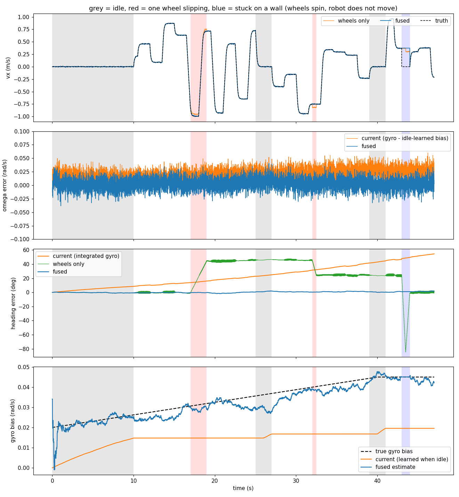

# Gyro + wheel odometry

The `odometry` node (runs on the Pi, started by `launch/robot.yaml`) fuses
the gyro (`imu`, 200 Hz) and the ESC wheel speeds (`wheels/state`, 50 Hz)
in an EKF (`odom_ekf.py`):

* **gyro bias tracked all the time**, not only while the robot is idle: the
  wheels' rotation tells the filter what the gyro should read
* **slipping wheel detection**: 4 wheels for 3 degrees of freedom (plus the
  gyro) leave redundancy; a wheel that disagrees with the rest is dropped
  from that update
* **gyro trusted for rotation**: wheels that disagree with the gyro on
  rotation are rejected instead of corrupting the bias
* stale wheels (NaN telemetry) are skipped; the other three still work

| Topic | Type | |
|---|---|---|
| `odom` | `nav_msgs/Odometry` | pose in the odometry frame (starts at 0) + body velocity + covariance, 100 Hz |
| `odom/gyro_bias` | `std_msgs/Float64` | bias estimate, rad/s |
| `odom/wheel_residuals` | `std_msgs/Float32MultiArray` | measured - fused wheel speed; a slipping wheel stands out |

`velocity_controller` keeps its own gyro logic unless started with
`use_odom: true` (in `launch/robot.yaml`); then heading hold and yaw-rate
feedback use the fused heading and omega.

Skid, impact, stall and push detection built on top of this: see
[EVENTS.md](EVENTS.md).

Known limit: all four wheels spinning together while the robot is stuck
(pushing a wall) looks like real motion to wheels + gyro. Vision
(`vision_filter`) is the reference that catches it.

## See it work without the simulator

**Offline demo** (47 s synthetic robot with bias drift, slipping wheels,
a dead wheel and a wall hit; compares against today's `velocity_controller`
logic and wheels-only velocity):

```bash
docker compose run -v $PWD/src/robot_control/doc:/out control \
    ros2 run robot_control odom_demo --plot /out/odom_demo.png
```

```
                                                current/wheels     fused
linear velocity RMS, normal (m/s)                        0.015     0.015
linear velocity RMS, one wheel slipping (m/s)            0.079     0.016
linear velocity RMS, stuck on wall (m/s)                 0.560     0.420
omega RMS (rad/s)                                        0.023     0.011
heading error just before stuck (deg)                   46.762     0.998
gyro bias error at end (rad/s)                           0.025     0.003
```



The heading comparison depends on the synthetic bias drift (0.020 -> 0.045
rad/s while warming up); with a steadier gyro today's method drifts less,
but it can only learn the bias while the robot sits still.

**Unit tests** (18 checks, 3 random runs):

```bash
docker compose run control bash -c "cd /ssl_ws/src/robot_control && python3 -m pytest -p no:cacheprovider test/test_odom_ekf.py -v"
```

**ROS pipeline with a fake robot** (on the PC, never on the robot: it
publishes `imu` and `wheels/state`):

```bash
docker compose run control ros2 run robot_control odometry        # terminal 1
docker compose run control ros2 run robot_control fake_robot      # terminal 2
docker compose run control ros2 run robot_control odom_check --ros-args -p seconds:=41.0   # terminal 3
```

## Check it on the real robot

Rebuild the robot image once (adds numpy if missing): `docker compose build robot`.
Then, with the robot running, from the robot or any machine on its ROS network:

```bash
ros2 run robot_control odom_check --ros-args -p seconds:=60.0
```

* **still**: leave the robot untouched for the whole run. Expect fused speed
  close to 0, heading drift much lower than the raw gyro's, and it prints
  `sigma_gyro` / `sigma_wheel` measured on your hardware; put those in
  `robot.yaml` as odometry parameters.
* **spin**: mark the heading, turn N full turns, return to the mark:
  `total rotation` should read N x 360 deg. Fused should beat raw gyro and
  wheels only. If wheels-only is consistently off by a few %, recalibrate
  `robot_radius`.
* **straight**: drive along a tape measure; `distance` should match. A
  consistent error is `wheel_radius`.
* **slip**: lift one wheel or let it spin on a slippery spot: its count in
  `readings > 3 sigma` (and the node's `slips` log) goes up, the others don't.
* then set `use_odom: true` for `velocity_controller` in `launch/robot.yaml`
  and compare heading hold while driving straight.
